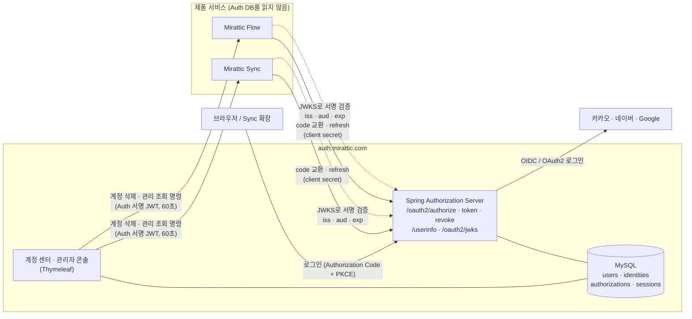

# Mirattic Auth

Mirattic 서비스 전체가 함께 쓰는 **중앙 인증 서버**입니다. OAuth 2.0 / OpenID Connect 제공자로서 전역 사용자 ID(UID), 로그인 수단, 세션 · 토큰, 계정 관리를 맡습니다.
[Mirattic Sync](https://github.com/G1Se0k/mirattic-sync)와 [Mirattic Flow](https://github.com/G1Se0k/MiratticFlow)는 비밀번호도 자체 로그인도 없이, 이 서버가 발급한 토큰만 검증합니다.

**🔗 [auth.mirattic.com](https://auth.mirattic.com)** — 계정 하나로 Sync와 Flow에 SSO로 로그인합니다.

| | |
| --- | --- |
| 백엔드 | Java 21 · Spring Boot 4.1 · **Spring Authorization Server** · Spring Security · OAuth2 Client · Thymeleaf |
| 데이터 | MySQL 8.4 · Spring JDBC · Spring Session JDBC · Flyway (V1–V7) |
| 토큰 | JWT RS256 + JWKS(`kid` = RFC 7638 thumbprint) · opaque refresh token(회전) |
| 로그인 | 카카오 · 네이버 · Google (이메일 · 비밀번호 로그인은 코드는 있으나 운영에서 꺼 둠) |
| 인프라 | AWS Lightsail · Cloudflare · Caddy · Docker Compose · GitHub Actions |
| 테스트 | 75개 (대부분 Testcontainers MySQL 통합 테스트, 소셜 제공자는 테스트 스텁) |

<p align="center"></p>

---

## 아키텍처



**경계를 지키는 규칙**
- 제품 서비스는 Auth DB를 직접 읽지 않고, 비밀번호를 받거나 저장하지 않습니다. 제품이 가진 것은 `sub`(UID)를 키로 한 자기 데이터뿐입니다.
- 클라이언트가 보낸 사용자 ID는 믿지 않고, 토큰의 서명 · `iss` · `aud` · `exp`를 검증한 `sub`만 씁니다.
- 매 API 요청마다 Auth를 거치지 않습니다. Auth가 잠시 내려가도 이미 발급된 access token(15분)은 만료 전까지 유효합니다.

| | Sync | Flow |
| --- | --- | --- |
| client | `mirattic-sync` (confidential + PKCE S256) | `mirattic-flow` (confidential + PKCE S256) |
| token `aud` | `mirattic-sync` | `mirattic-flow` |
| access / refresh | JWT 15분 / opaque 30일, 사용할 때마다 회전 | 같음 |
| 토큰 보관 | 확장이 Auth 토큰을 보관, refresh는 Sync 서버가 중계 | Flow 서버가 HttpOnly 쿠키로 보관 |

---

## 주요 기술 결정

### 1. 제품은 Auth 토큰을 끝까지 쓴다 (자체 세션을 만들지 않는다)

Sync를 이전할 때 두 안을 비교했습니다.
- A안: Auth로 로그인한 뒤 Sync가 자기 세션을 다시 발급합니다. 계정 정지 · 로그아웃이 Sync에 닿기까지 최대 30일(Sync refresh 수명)이 걸리고, 계정 센터가 Sync 세션을 볼 수 없습니다.
- **B안(채택):** 확장이 Auth 토큰을 그대로 쓰고 Sync는 JWKS로 검증만 합니다. 계정 정지 · 비밀번호 변경 · 로그아웃이 **access token 수명(15분) 안에** 모든 제품에 반영됩니다.

이전은 기존 UUID를 그대로 전역 UID로 보존하고, 기존 로그인과 Auth 토큰을 동시에 받는 단계 → 확장 전환 → 기존 인증 제거 순서로 진행했습니다.

### 2. refresh token 회전과 재사용 탐지

- refresh할 때마다 새 refresh token을 주고 이전 것은 무효가 됩니다. 같은 토큰으로 동시에 refresh하면 **행 잠금 compare-and-swap으로 정확히 하나만 성공**합니다.
- 회전된 토큰이 **10초 넘게 지나서** 다시 제출되면 탈취로 보고 그 로그인의 토큰 전체(새 refresh token 포함)를 폐기합니다. 10초 안의 재제출은 정상 재시도와 구분할 수 없어서 거절만 합니다.
- 이미 쓴 authorization code를 다시 쓰면 그 code로 발급된 토큰을 폐기합니다.
- refresh token · authorization code 같은 토큰 값은 **해시로만 저장**합니다(`HashedTokenAuthorizationService`).

### 3. 서명 키는 재시작해도 바뀌지 않고, 무중단으로 회전한다

재시작마다 키를 새로 만들면 이미 발급된 토큰이 모두 무효가 됩니다. 그래서 RSA 개인키(JWK)는 소스 밖 볼륨에 한 번 생성해 두고 매일 백업합니다.
회전은 `deploy/rotate-signing-key.sh rotate | retire` 두 단계로 합니다. 회전 중에는 **이전 키도 JWKS에 공개하고 서명만 새 키로** 하므로, 기존 토큰이 만료될 때까지 아무도 로그아웃되지 않습니다.

### 4. 계정 삭제는 제품 서비스와의 분산 작업이다

Mirattic 계정을 지우려면 Flow와 Sync의 데이터도 지워야 하는데, 세 서비스는 DB를 공유하지 않습니다.

1. **Fence:** 계정을 `DISABLED`로 바꾸고 다른 세션과 앱 로그인을 모두 끝냅니다. 이 상태에서는 로그인 · code 교환 · refresh · 계정 연결이 모두 막힙니다.
2. **삭제 명령:** Flow, 이어서 Sync에 Auth 키로 서명한 JWT를 보냅니다(`purpose=account_deletion`, `aud`=제품, 60초, `scope` 없음).
   - 제품은 이 목적의 토큰만 그 엔드포인트에서 받고, access token으로는 절대 받지 않습니다.
   - 응답은 **정확히 204여야** 성공입니다. Flow가 거절하면(409, 혼자 소유한 워크스페이스) 사용자에게 사유를 보여 주고 데이터는 지우지 않습니다. 1단계에서 끝난 세션 · 앱 로그인은 다시 로그인해야 합니다.
3. **확정:** 모두 성공해야 한 트랜잭션 안에서 계정을 `DELETED`로 바꿉니다. 이 전에 어디서든 실패하면 fence를 풉니다.
   - UID는 재사용되지 않도록 행을 남기고, 로그인 수단 · 토큰 · 세션은 지웁니다.

**알려진 한계:** 서비스 간 트랜잭션이 아니므로, Flow가 지운 뒤 Sync가 실패하면 Flow 데이터는 이미 지워진 채 계정이 `ACTIVE`로 돌아옵니다. 사용자에게 다시 시도하라고 안내하며, 제품의 삭제가 멱등(이미 없으면 204)이라 재시도로 마무리됩니다.

같은 서명 명령 방식(`purpose=admin_read`)을 관리자 콘솔이 제품의 통계 · 신고를 읽을 때도 재사용합니다(`ProductOrders`).

### 5. 계정 연결은 명시적으로만

같은 이메일이라는 이유로 계정을 자동으로 합치지 않습니다. 검증되지 않은 이메일로 남의 계정을 가져갈 수 있기 때문입니다.
- 연결 · 해제는 로그인한 사용자가 직접 시작하고(POST + CSRF), **최근 10분 안에 로그인**했어야 합니다. 아니면 재인증으로 보냅니다.
- 마지막 로그인 수단은 해제할 수 없습니다. 동시에 두 해제가 일어나도 `users` 행 잠금으로 막습니다.
- 해제하면 그 수단으로 로그인한 다른 세션과 앱 로그인도 끝냅니다.

### 6. 공격을 막되, 사용자를 잠그지 않는다

- **IP 기준 요청 제한:** 비밀번호를 받는 요청은 IP당 분당 20회입니다. IP는 Caddy가 Cloudflare 대역에서 온 요청에만 믿는 `CF-Connecting-IP` 기준입니다.
- **계정 잠금은 두지 않습니다.** 계정 기준 로그인 잠금은 공격자가 남의 계정을 일부러 잠그는 DoS가 되기 때문입니다.
- **계정 열거 방지:** 로그인 실패는 이유와 무관하게 같은 오류를 냅니다. 비밀번호 재설정 요청은 조회 · 토큰 생성 · 메일 발송을 모두 비동기로 처리해, 응답 시간으로 가입 여부를 알 수 없습니다.
- **재설정 토큰:** 32바이트 난수이고 SHA-256만 저장하며 30분 뒤 만료됩니다. 링크가 URL에 있으므로 모든 페이지에 `Referrer-Policy: no-referrer`를 둡니다.
- **가입 제한:** 이메일 인증을 두지 않는 대신 네트워크(IPv4 주소 / IPv6 /64)당 24시간에 한 계정만 가입할 수 있습니다. 이를 위해 저장하는 IP는 평문 해시가 아니라 호스트 비밀키로 만든 HMAC-SHA256입니다.
- **로그에 남기지 않는 것:** 비밀번호, 원본 refresh token, 재설정 토큰, authorization code.

### 7. 세션은 DB에, 재로그인 요구는 요청 단위로

- 브라우저 세션은 Spring Session JDBC로 MySQL에 저장해 배포 · 재시작에도 유지됩니다. 비밀번호를 변경하면 다른 세션이, 재설정하면 모든 세션이 끝납니다.
- 제품이 `prompt=login`으로 재인증을 요구하면 **그 요청에만** 새 로그인이 적용됩니다. access token에 `auth_time`이 실리므로 제품은 "최근 N분 안의 로그인"을 직접 확인할 수 있습니다(Flow 탈퇴, Sync 데이터 삭제).

---

## 계정 센터 · 운영

- **계정 센터:** 로그인된 기기 목록과 기기별 로그아웃, 소셜 계정 연결 · 해제, 최근 보안 활동(로그인 · 연결 · 비밀번호 변경 등), 탈퇴를 제공합니다.
- **관리자 콘솔(`/admin`):** 운영자 UID만 접근합니다. 사용자 검색, 정지 · 해제 · 전체 로그아웃(최근 로그인 필요, 자기 자신 불가, 기록 남김)을 지원합니다. Sync · Flow 통계와 신고 · 피드백은 읽기 전용입니다. 신고 시점에 복사해 둔 신고 대상 메시지 외의 채팅 · 이슈 내용은 보지 않습니다.
- **정리 작업:** 매시간 만료된 authorization과 재설정 토큰을 지웁니다.
- **배포:** main push → 테스트 → Docker 이미지 → SSH로 전송 → `deploy.sh`(헬스 체크 실패 시 롤백). 레지스트리 없이 배포합니다. DB 비밀번호 · 클라이언트 secret · 가입 제한용 HMAC 키는 첫 배포 때 호스트에서 생성하고, 메일 · 소셜 로그인 키는 호스트의 `.env`에 직접 넣습니다(비어 있으면 배포를 거부).
- **백업 · 모니터링:** DB와 서명 키를 매일 백업해 7일 보관합니다. 5분 간격 가동 확인(Flow 저장소의 GitHub Actions)이 실패하면 GitHub 실패 알림으로 받습니다.

## 테스트

테스트 75개이고, 대부분 Testcontainers MySQL 위의 통합 테스트입니다(필터 · 서명 키 같은 단위 테스트 포함).
- OAuth 흐름: code + PKCE, 회전 · 재사용 탐지, 동시 refresh, code 재사용
- 계정 삭제의 fence와 실패 시 복구, 계정 연결 · 해제 경합, 요청 제한, 관리자 권한

---

## 로컬 실행

```sh
docker compose up -d                      # MySQL
./mvnw spring-boot:run -Dspring-boot.run.profiles=local
# http://127.0.0.1:9000 — local 프로파일: 이메일 로그인 켜짐, 개발용 client secret 내장
#   mirattic-sync: dev-sync-secret (redirect http://127.0.0.1:8080/auth/callback)
#   mirattic-flow: dev-flow-secret (redirect http://127.0.0.1:3000/auth/callback)
./mvnw test                               # Docker 필요
```

문서: [아키텍처](docs/architecture.md) · [OAuth/OIDC](docs/oauth-oidc.md) · [클라이언트](docs/clients.md) · [보안](docs/security.md) · [데이터 모델](docs/data-model.md) · [이전 계획](docs/migration.md) · [배포](docs/deployment.md)

---

## Mirattic

| 저장소 | 설명 |
| --- | --- |
| [mirattic-main](https://github.com/G1Se0k/mirattic-main) | 전체 시스템 개요 · mirattic.com |
| **mirattic-auth** | 중앙 인증 서버 (이 저장소) |
| [mirattic-sync](https://github.com/G1Se0k/mirattic-sync) | 워치파티 확장 + 서버 |
| [MiratticFlow](https://github.com/G1Se0k/MiratticFlow) | 팀 협업 · 이슈 관리 |
