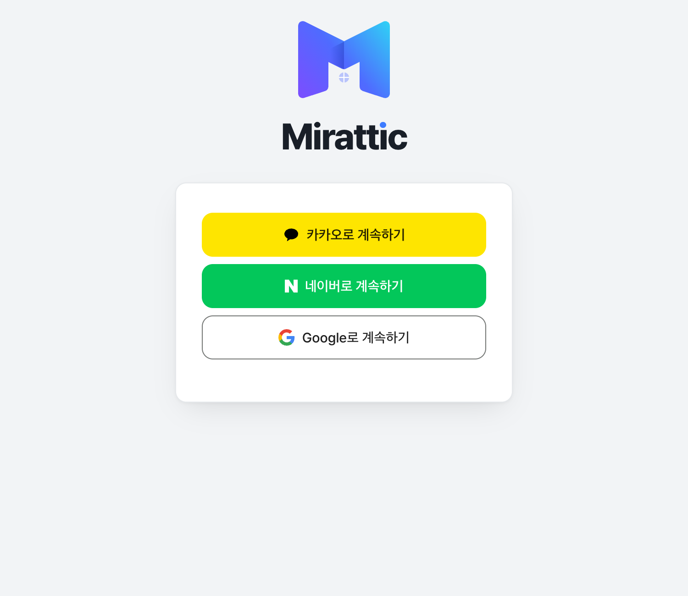
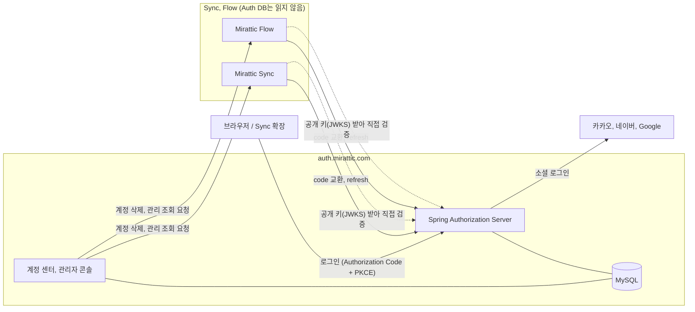

# Mirattic Auth

Mirattic 서비스들이 같이 쓰는 로그인 서버입니다. 계정 하나로 [Mirattic Sync](https://github.com/G1Se0k/mirattic-sync)와 [Mirattic Flow](https://github.com/G1Se0k/MiratticFlow)에 들어갈 수 있게 해 줍니다.

OAuth 2.0 / OpenID Connect 제공자로 동작하고, 사용자 ID(UID), 로그인 수단, 세션과 토큰, 계정 관리를 여기서만 다룹니다. Sync와 Flow는 비밀번호를 받지 않고 토큰도 직접 만들지 않습니다. 로그인을 시작해 code를 토큰으로 바꾸고, 그 토큰을 검증해서 쓰는 데까지만 합니다.

[auth.mirattic.com](https://auth.mirattic.com)

| | |
| --- | --- |
| 서버 | Java 21, Spring Boot 4.1, Spring Authorization Server, Spring Security, OAuth2 Client, Thymeleaf |
| 데이터 | MySQL 8.4, Spring JDBC, Spring Session JDBC, Flyway |
| 토큰 | JWT(RS256) + JWKS, refresh token은 쓸 때마다 새로 발급 |
| 로그인 | 카카오, 네이버, Google (이메일 로그인 코드도 있지만 운영에서는 꺼 두었습니다) |
| 인프라 | AWS Lightsail, Cloudflare, Caddy, Docker Compose, GitHub Actions |
| 테스트 | 75개 |

<p align="center"></p>

## 구조



서비스끼리 지키는 원칙은 단순합니다. Sync와 Flow는 Auth DB를 직접 읽지 않고, 토큰의 `sub`(UID)를 키로 자기 데이터만 가집니다. 클라이언트가 보낸 사용자 ID는 믿지 않고, 서명과 발급자, 대상, 만료를 확인한 토큰의 UID만 씁니다.
요청마다 Auth를 거치지는 않습니다. 그래서 Auth가 잠깐 내려가도 이미 받은 access token(15분)은 만료될 때까지 쓸 수 있습니다.

| | Sync | Flow |
| --- | --- | --- |
| client | `mirattic-sync` | `mirattic-flow` |
| 방식 | confidential client + PKCE | confidential client + PKCE |
| 토큰 수명 | access 15분, refresh 30일 | 같음 |
| 토큰 보관 | 확장이 보관하고 refresh는 Sync 서버가 대신 요청 | Flow 서버가 HttpOnly 쿠키로 보관 |

## 고민했던 것들

### Sync가 자기 세션을 다시 만들지 않게 한 이유

Sync를 Auth로 옮길 때 두 가지 방법을 놓고 고민했습니다.

하나는 Auth로 로그인한 다음 Sync가 자기 세션을 새로 발급하는 방법입니다. 기존 코드를 덜 고쳐도 되지만, Auth에서 계정을 정지하거나 로그아웃해도 Sync 세션이 살아 있는 동안(최대 30일)은 모르고 지나갑니다. 계정 센터에서 Sync 로그인을 볼 수도 없습니다.
다른 하나는 확장이 Auth 토큰을 그대로 쓰고 Sync는 검증만 하는 방법입니다. 이쪽을 골랐고, 덕분에 계정 정지나 비밀번호 변경, 로그아웃이 access token 수명인 15분 안에 새 요청부터 막힙니다. 다만 이미 열려 있던 Sync의 WebSocket 연결은 그대로 이어지다가, 끊기고 다시 연결할 때 막힙니다.

옮길 때 운영 Sync에는 실제 사용자가 없고 테스트 계정 하나뿐이어서, 기존 계정을 Auth로 옮기는 단계는 건너뛰었습니다. 한동안 옛 토큰과 Auth 토큰을 둘 다 받다가, 확장을 바꾼 뒤 옛 인증을 지웠습니다.

### refresh token이 털렸을 때

refresh token은 쓸 때마다 새 것으로 바꾸고 이전 것은 못 쓰게 합니다. 같은 토큰으로 동시에 두 번 요청이 오면, 행 잠금으로 비교하고 바꾸기 때문에 하나만 성공합니다.

애매했던 건 "이미 바꾼 토큰이 다시 들어오는 경우"입니다. 누가 훔쳐서 쓰는 걸 수도 있고, 앱이 네트워크 오류로 재시도한 걸 수도 있습니다. 바뀐 지 10초가 넘었는데 다시 오면 도용으로 보고 그 로그인에 딸린 토큰을 전부 폐기하고, 10초 안이면 거절만 하도록 선을 그었습니다.
이미 쓴 authorization code가 다시 들어와도 그 code로 발급한 토큰을 폐기합니다. 토큰 값은 DB에 해시로만 저장합니다.

### 서명 키를 바꿔도 아무도 로그아웃되지 않게

서버를 재시작할 때마다 키를 새로 만들면, 그 전에 발급한 토큰이 전부 무효가 됩니다. 그래서 RSA 키는 볼륨에 한 번 만들어 두고 매일 백업합니다.
키를 바꿀 때는 `deploy/rotate-signing-key.sh`로 두 단계를 밟습니다. 먼저 새 키로 서명을 시작하되 이전 키도 공개 키 목록에 남겨 두고, 이전 키로 서명한 토큰이 다 만료된 뒤에 이전 키를 내립니다.

### 계정 삭제는 세 서비스에 걸친 작업

Mirattic 계정을 지우면 Flow와 Sync에 있는 데이터도 지워야 합니다. 그런데 셋은 DB를 공유하지 않아서 트랜잭션 하나로 묶을 수 없습니다. 그래서 순서를 정했습니다.

먼저 계정을 잠급니다. 상태를 `DISABLED`로 바꾸고 다른 세션과 앱 로그인을 끝내서, 지우는 도중에 누가 로그인하거나 토큰을 새로 받지 못하게 합니다.
그다음 Flow, Sync 순서로 "이 UID 데이터를 지워라"라는 요청을 보냅니다. 요청에는 Auth 키로 서명한 60초짜리 JWT를 붙이고, 받는 쪽은 이 용도의 토큰만 그 엔드포인트에서 받습니다. 둘 다 정확히 204로 답해야 성공입니다.
마지막으로 계정을 `DELETED`로 바꾸고 로그인 수단, 토큰, 세션을 지웁니다. UID가 다시 쓰이지 않도록 사용자 행 자체는 남깁니다.

중간에 오류가 나면 잠금을 풉니다. Auth 서버 자체가 도중에 죽으면 계정이 `DISABLED`로 남아서 손으로 풀어야 합니다. Flow는 사용자가 혼자 가진 워크스페이스가 있으면 삭제를 거절하는데, 그때는 이유를 보여 주고 아무 데이터도 지우지 않습니다(처음에 끝낸 로그인은 다시 해야 합니다).
한계도 있습니다. Flow는 지웠는데 Sync가 실패하면 Flow 데이터만 지워진 채로 계정이 돌아옵니다. 각 서비스의 삭제가 여러 번 불러도 같은 결과(이미 없으면 204)가 나오게 만들어 두어서, 다시 시도하면 마무리됩니다.
아직 남은 틈도 하나 있습니다. 잠그기 직전에 받은 토큰으로 Sync 로그인 콜백이 늦게 도착하면, Sync가 204로 답한 뒤에 프로필이 다시 생길 수 있습니다. Flow는 UID별로 삭제 시각을 기록해 이걸 막았고, Sync에는 아직 같은 장치가 없습니다.

관리자 콘솔이 Sync와 Flow의 통계나 신고를 읽어 올 때도 같은 방식의 서명 요청을 씁니다.

### 같은 이메일이어도 계정을 합치지 않습니다

이메일이 같다고 계정을 자동으로 합치면, 검증되지 않은 이메일 하나로 남의 계정에 들어갈 수 있습니다. 그래서 연결은 로그인한 사용자가 계정 센터에서 직접 해야 하고, 10분 안에 로그인한 적이 있어야 합니다.
마지막 남은 로그인 수단은 해제할 수 없고, 두 해제가 동시에 들어와도 사용자 행을 잠가서 둘 다 통과하지 못하게 했습니다.

### 막되, 사용자를 잠그지는 않기

비밀번호를 받는 요청은 IP당 분당 20번으로 제한합니다. 여기서 IP는 Cloudflare를 거쳐 온 요청의 실제 사용자 IP입니다.
반대로 "로그인 몇 번 틀리면 계정 잠금"은 두지 않았습니다. 그러면 남의 계정을 일부러 잠가 버리는 공격이 가능해지기 때문입니다.

로그인과 비밀번호 재설정에서는 가입 여부가 새지 않게 했습니다. 로그인 실패 메시지는 이유와 상관없이 똑같고, 재설정 요청은 조회와 메일 발송을 전부 비동기로 돌려서 응답 시간으로도 알 수 없습니다. 이메일 가입 화면은 이미 있는 이메일이면 그렇다고 알려 줍니다. 이메일 인증을 두지 않기로 하면서 받아들인 부분이고, 위의 IP당 분당 20회 제한으로 대량 조회 속도를 늦춥니다.
이메일 인증을 넣지 않은 대신, 이메일로 가입할 때는 같은 네트워크에서 24시간에 한 계정만 만들 수 있습니다(소셜 가입은 해당 없고, 지금 운영에서는 이메일 가입 자체를 꺼 두었습니다). 이를 위해 IP를 저장하는데, 단순 해시는 IP 범위가 작아 쉽게 역산되니 서버에만 있는 키로 HMAC을 만들어 저장합니다.

비밀번호, 원본 refresh token, 재설정 토큰, authorization code는 로그에 남기지 않습니다.

### 다시 로그인하라고 할 때

브라우저 세션은 MySQL에 저장해서(Spring Session JDBC) 배포하거나 재시작해도 로그인이 풀리지 않습니다.
탈퇴처럼 민감한 작업 앞에서 서비스가 "다시 로그인해 주세요"(`prompt=login`)를 요청하면, 그 요청에만 새 로그인을 적용합니다. access token에 마지막 로그인 시각(`auth_time`)이 들어 있어서, 서비스가 "최근 몇 분 안에 로그인했는지"를 직접 확인할 수 있습니다.

## 계정 센터와 운영

계정 센터에서는 로그인된 기기를 보고 기기별로 로그아웃할 수 있고, 소셜 계정을 연결하거나 끊고, 최근 보안 활동을 보고, 탈퇴할 수 있습니다.

관리자 콘솔(`/admin`)은 운영자 UID로만 들어갑니다. 사용자를 찾아서 정지하거나 모든 기기에서 로그아웃시킬 수 있고, 이런 조치는 기록으로 남습니다. Sync와 Flow의 통계, 신고, 피드백은 읽기만 합니다. 신고 당시 복사해 둔 메시지 말고는 채팅이나 이슈 내용을 보지 않습니다.

main에 푸시하면 테스트를 돌리고, 배포가 켜져 있으면(저장소 변수 `DEPLOY_ENABLED`) 이미지를 만들어 SSH로 서버에 보낸 뒤 `deploy.sh`가 바꿔 끼웁니다. 헬스 체크에 실패하면 이전 이미지로 돌아갑니다.
DB 비밀번호나 client secret 같은 값은 첫 배포 때 서버에서 직접 만들고, 메일과 소셜 로그인 키는 서버의 `.env`에 손으로 넣습니다. 빠져 있으면 배포가 멈춥니다.
DB와 서명 키는 매일 백업해서 7일치를 남기고, 만료된 토큰과 재설정 토큰은 하루 여유를 두고, 한 시간마다 도는 작업이 지웁니다.

## 테스트

75개이고 대부분 Testcontainers로 MySQL을 띄워 돌리는 통합 테스트입니다. 로그인 흐름(code와 PKCE, refresh 재발급, 도용 감지, 동시 요청), 계정 삭제가 중간에 실패했을 때의 복구, 계정 연결과 해제가 겹칠 때, 요청 제한, 관리자 권한 같은 것들을 확인합니다. 소셜 로그인 제공자는 테스트용 가짜 서버로 대신합니다.

## 로컬에서 돌리기

```sh
docker compose up -d       # MySQL
./mvnw spring-boot:run -Dspring-boot.run.profiles=local
# http://127.0.0.1:9000
# local 프로파일에서는 이메일 로그인이 켜져 있고, 개발용 client secret이 들어 있습니다
#   mirattic-sync: dev-sync-secret (redirect http://127.0.0.1:8080/auth/callback)
#   mirattic-flow: dev-flow-secret (redirect http://127.0.0.1:3000/auth/callback)
./mvnw test                # Docker 필요
```

더 자세한 내용은 [docs](docs/) 폴더에 있습니다. [OAuth/OIDC](docs/oauth-oidc.md), [클라이언트](docs/clients.md), [보안](docs/security.md), [데이터 모델](docs/data-model.md), [이전 계획](docs/migration.md), [배포](docs/deployment.md) 문서를 보면 됩니다.

## 다른 저장소

- [mirattic-main](https://github.com/G1Se0k/mirattic-main): 전체 구성과 mirattic.com
- [mirattic-sync](https://github.com/G1Se0k/mirattic-sync): 같이 보기 확장과 서버
- [MiratticFlow](https://github.com/G1Se0k/MiratticFlow): 팀 협업, 이슈 관리
